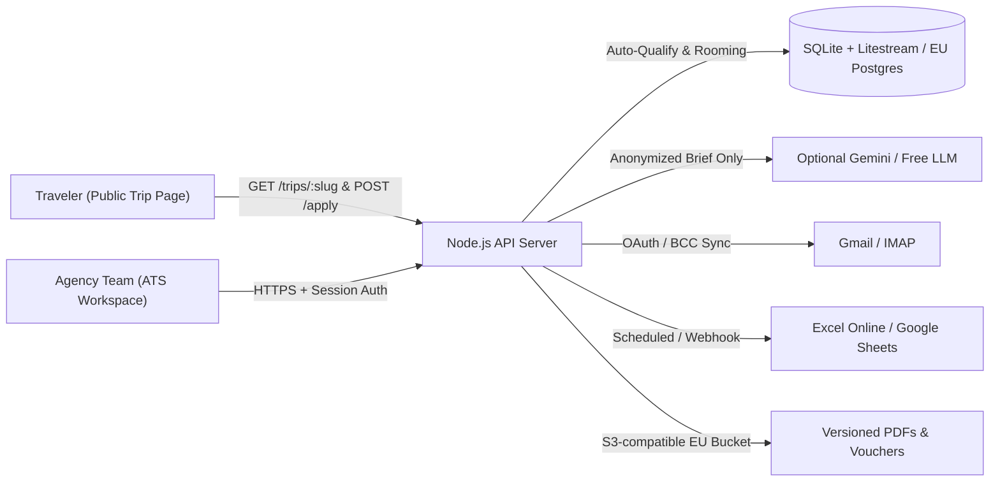
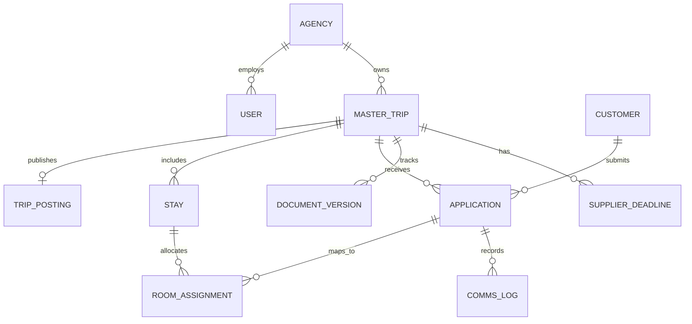

# ARCHITECTURE.md — System Architecture & Data Model

## 1. Current Prototype (Phase 0)

- **Runtime:** Dependency-free Node.js 20+ HTTP server (`server.mjs`).
- **Frontend:** Vanilla HTML/CSS/ES modules (`public/index.html`, `public/styles.css`, `public/app.js`, `public/trip-utils.js`, `public/template-utils.js`, `public/csv-utils.js`, `public/date-utils.js`).
- **Persistence:** Browser `localStorage` (`travelagencyos_garlic_v2`) + optional local `.csv` file handle via File System Access API.
- **AI Proxy:** `POST /api/offer-draft` in `server.mjs` keeps `GEMINI_API_KEY` server-side, rate-limits (10 req/min), and strips PII.

---

## 2. Proposed Production / Pilot Architecture (Phase 1 — Before Live Data)

Designed to stay within the **~€1,000 initial budget** (€10–€25/month hosting on an EU VPS such as Hetzner/DigitalOcean Frankfurt/EU + automated backups).

---

## 3. Core Data Model (Phase 1)

### Entity Breakdown

- **`Agency`**: `{ id, name, slug, brandColorsJson, defaultCurrency }`
- **`User`**: `{ id, agencyId, email, role ('owner' | 'agent') }`
- **`MasterTrip`**: `{ id, agencyId, title, destination, startDate, endDate, maxPax, costPerPax, pricePerPax, fixedCost, currency }`
- **`TripPosting`** *(public "Job" layer)*: `{ id, tripId, slug, status ('draft' | 'published' | 'full' | 'archived'), publicSummary, includedText, excludedText, customQuestionsJson }`
- **`Stay`** *(multi-accommodation)*: `{ id, tripId, name, nights, doubleRooms, singleRooms, sortOrder }`
- **`Customer`**: `{ id, agencyId, name, channel, email, phone, notes }` *(live PII encrypted at rest + GDPR retention)*
- **`Application`**: `{ id, tripId, customerId, pax, budgetPerPax, answersJson, qualificationStatus, qualificationReasonsJson, stage, depositPaidAmount }`
- **`RoomAssignment`**: `{ id, applicationId, stayId, roomType, roomCode }`
- **`DocumentVersion`**: `{ id, tripId, title, kind, audience ('client' | 'supplier'), version, fileKey, sentLogJson }`
- **`SupplierDeadline`**: `{ id, tripId, supplierName, kind ('rooming_cutoff' | 'deposit' | 'balance'), dueDate, amount, currency, done }`
- **`CommsLog`**: `{ id, tripId, applicationId, channel ('email' | 'whatsapp' | 'note'), direction, subject, snippet, createdAt }`

---

## 4. Non-Negotiable Security & Privacy Gates for Phase 1

1. **Public vs. Private API Separation:** Public `GET /api/public/trips/:slug` and `POST /api/public/trips/:slug/apply` must NEVER return `costPerPax`, `fixedCost`, `profit`, or other applicants' data.
2. **EU Data Residency & GDPR:** Store live traveler data in EU region; implement `Export my data` and `Delete traveler record` before onboarding any pilot agency.
3. **Zero Silent AI Data Sharing:** Never send traveler names, emails, or passport data to external free-tier AI models.
4. **Accountant Sign-Off:** Keep ANAF / e-Factura / VAT margin calculations out of the app until reviewed by a Romanian accountant.
